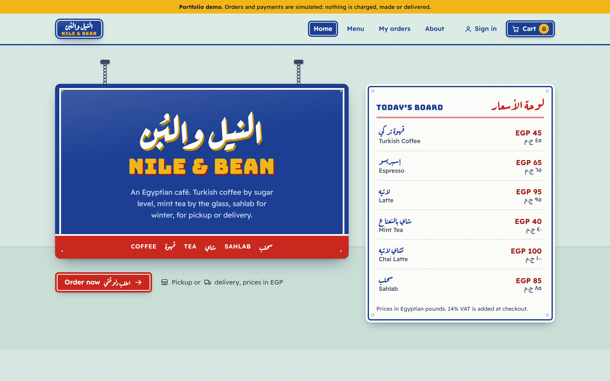
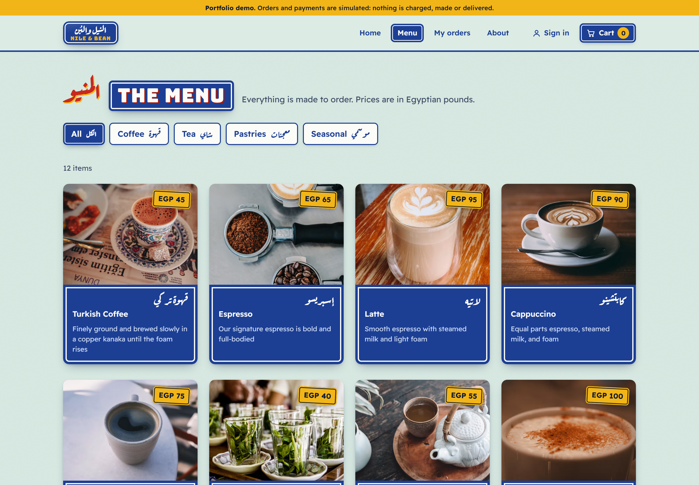
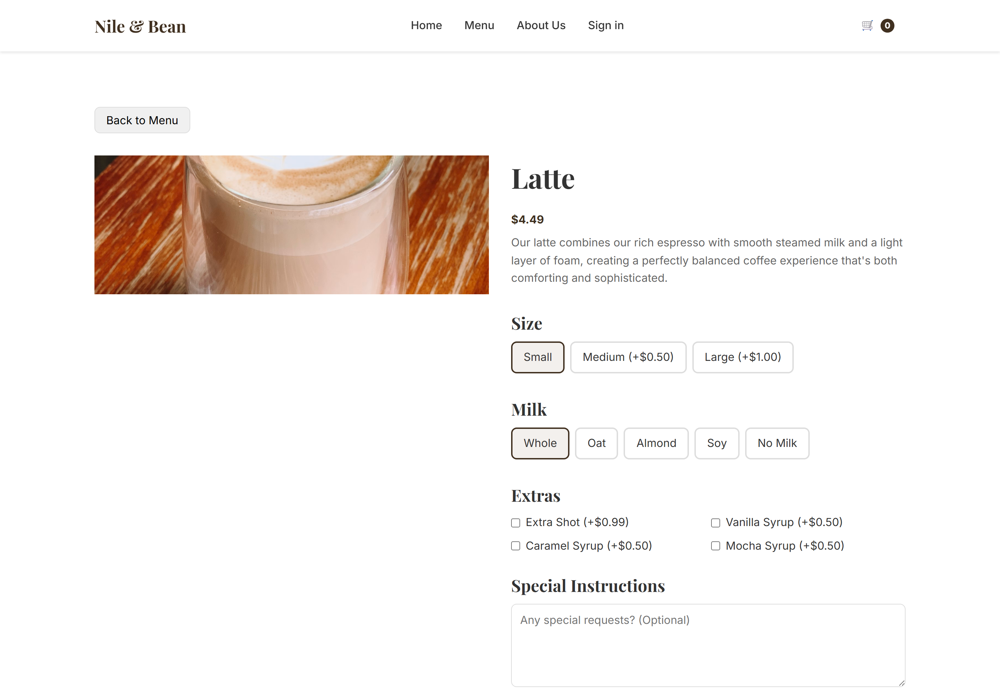
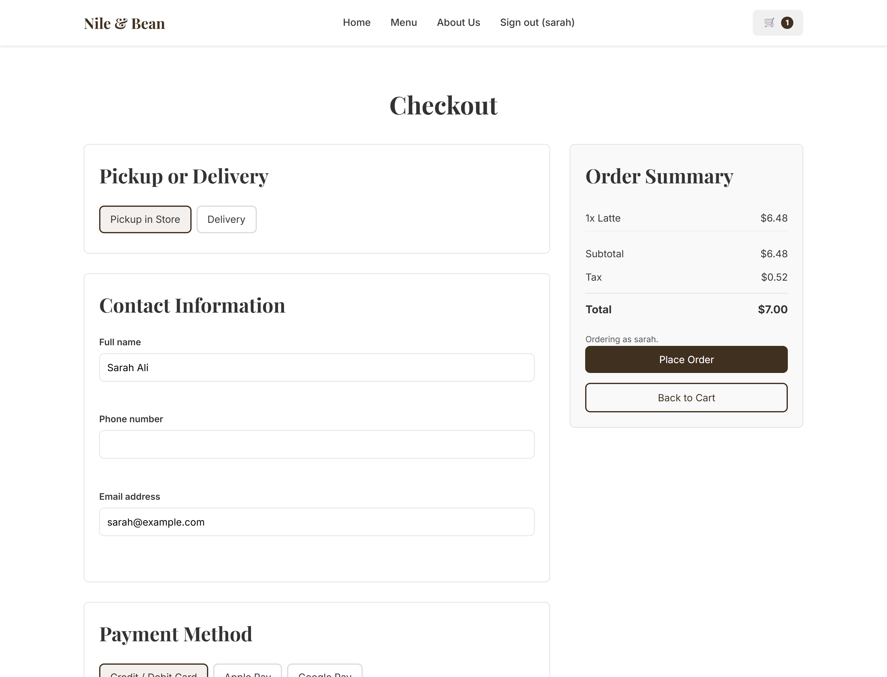
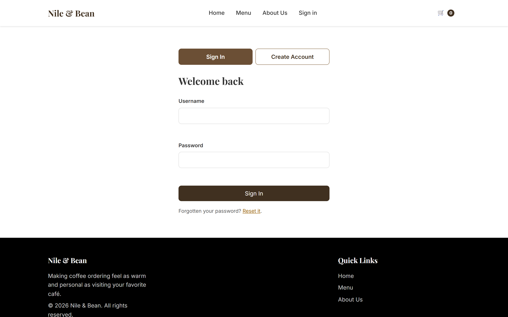
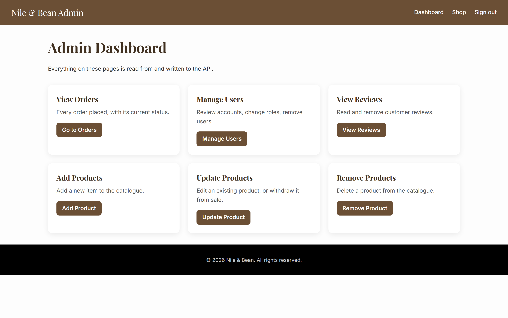
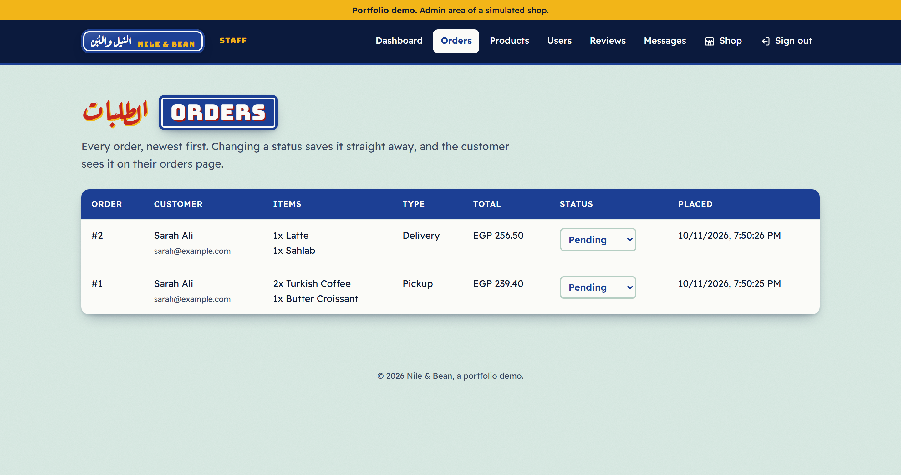
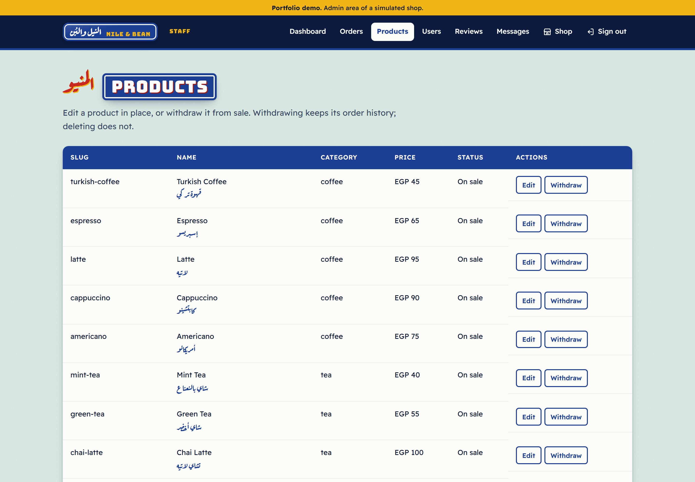
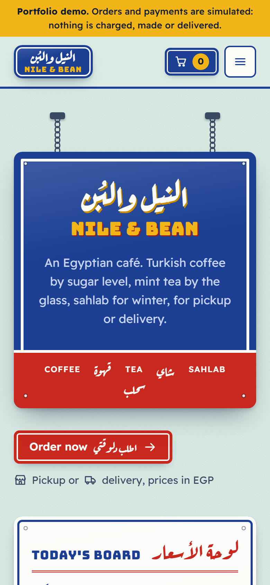

# Nile & Bean

An online coffee shop: browse a menu, configure a drink, and place an order for
pickup or delivery. Staff sign in to manage orders, products, users and reviews.

Vanilla JavaScript frontend, FastAPI backend, SQLite.



---

## What this repository is

This started as a **university software-engineering deliverable credited to a team of
five**: Muhammed Mahmoud Ahmed, Ziad Mohamed, Mohammed Mahmood Hamed, Aliaa Nagdy and
Menna Ahmed Reda. That deliverable is the first commit,
[`41c611b`](../../commit/41c611b), imported unmodified.

Two of us wrote the code: **I built the backend, Ziad Mohamed built the frontend and
the design.**

Everything after that first commit — the audit, the removals, the bug fixes, the
rebuilt API, the authentication, the tests — is **my own work, done solo**. The
history is deliberately unsquashed so the two are separable: `git diff 41c611b HEAD`
is exactly the boundary between what the team delivered and what I changed.

### What existed when I took it over

Three codebases in one folder, only one of which ran:

- **A static site that worked** — 13 hand-written HTML pages, ~960 lines of vanilla
  JS, a 977-line stylesheet, designed and built by Ziad. This is what a visitor
  actually saw.
- **A FastAPI skeleton that was never connected** — 138 lines, my own. One of its four
  endpoints did real work; two returned the literal string
  `"List of products will be here"`. The frontend made **zero** network calls to it,
  and its static mount pointed at a hardcoded absolute Windows path
  (`C:\Sw_project_Deliverable-_3-main`) belonging to a different directory.
- **An unreachable generated scaffold** — a complete React + Vite + shadcn/ui
  application in `src/`, 73 files and 6,863 lines, produced by Lovable.dev. No HTML
  file referenced it. It could not execute in any mode.

Plus 1,935 lines of stale duplicate JS and CSS at the repository root, shadowing the
live copies in `js/` and `css/`.

**Two-thirds of the tracked files could not run.**

The application also had no authentication (the admin pages were open to anyone who
typed the URL), no tests, no error handling, no checkout validation, and three
structural bugs serious enough that the menu page rendered nothing and the cart
charged customers less than it quoted them.

### What I did

Read the full findings in **[AUDIT.md](AUDIT.md)**. In short:

| | |
|---|---|
| **Audited** | Documented the received state with every claim marked as executed, read, or inferred. The three structural bugs were reproduced in a browser before being fixed. |
| **Deleted** | 16,257 lines across 96 unreachable files — the React scaffold, the duplicate root assets, generator config and lockfiles, and the vendor telemetry script that shipped on every public page. |
| **Fixed** | The menu rendering nothing, the cart UI never updating, and option upcharges being displayed and then dropped. Plus filename casing that would 404 on any Linux host, and unguarded `JSON.parse` calls that blanked the site on a corrupt storage value. |
| **Connected** | Rewrote the backend into a real API — 19 endpoints, JWT auth, admin authorization, Alembic migrations, server-computed order totals — and rewired the whole frontend onto it. |
| **Secured** | Added login, logout, role checks on every admin endpoint, and validation at every boundary. Order totals are computed from the database; a price sent by a client is ignored. |
| **Tested** | 123 tests where there were none, plus CI on every push. |
| **Measured** | 115 colour pairs checked in a real browser for WCAG AA; every page verified at 360, 768 and 1440px. |

The three bugs, concretely:

1. **The menu page rendered zero products.** `window.NileBean` exported the product
   array *by value* while it was still empty, and the loader later rebound the
   variable to a new array. The export stayed a permanently-empty snapshot.
2. **The cart UI never updated.** `main.js` and `cart.js` each parsed their own copy
   of the cart from `localStorage`. Handlers mutated one and re-rendered from the
   other, so clicking "+" three times produced one stored increment and no visible
   change at all.
3. **Customers were charged less than they were quoted.** The product page priced
   size and extras correctly and displayed the total, then added the item to the
   cart at its *base* price — while still listing the chosen options on the line. A
   $5.49 espresso was billed at $2.99.

---

## Running it

Requires **Python 3.13+** and, for the frontend tests only, **Node 20+**.

### Backend and site

```bash
cd Backend
python -m venv .venv
```

Activate it — `.venv\Scripts\activate` on Windows, `source .venv/bin/activate`
elsewhere — then:

```bash
pip install -r requirements.txt
alembic upgrade head
python seed.py
uvicorn app.main:app --reload
```

Open **http://127.0.0.1:8000**. FastAPI serves the site and the API from the same
origin, so there is nothing else to start. Interactive API docs are at
**http://127.0.0.1:8000/docs**.

The database is created by `alembic upgrade head` at `Backend/cafe.db` and is
gitignored — it is generated, never committed. `seed.py` loads the nine products
from `Backend/seed_data.json`; it is idempotent, so re-running it is safe.

### Demo accounts

Created by `seed.py`. Change them before deploying anywhere real.

| Username | Password | Role |
|---|---|---|
| `admin` | `admin-password-123` | Administrator |
| `sarah` | `customer-password-123` | Customer |

Override with `SEED_ADMIN_PASSWORD` and `SEED_CUSTOMER_PASSWORD`.

### Tests

```bash
cd Backend && python -m pytest
```

```bash
npm install && npm test
```

### Configuration

All optional; every one has a working default.

| Variable | Default | Purpose |
|---|---|---|
| `DATABASE_URL` | `sqlite:///Backend/cafe.db` | Database location |
| `SECRET_KEY` | a development value | JWT signing key. **Set this in production** — the default is public, and anyone who knows it can mint a valid token. |
| `ACCESS_TOKEN_EXPIRE_MINUTES` | `60` | Token lifetime |
| `TAX_RATE` | `0.08` | Sales tax, applied server-side |
| `ENVIRONMENT` | `development` | `development` enables the dev CORS allow-list |
| `CORS_ORIGINS` | empty | Comma-separated allow-list when `ENVIRONMENT` is not `development` |

---

## Architecture

```
deliverable_03-master/
├── index.html  menu.html  product.html  cart.html  about.html   customer pages
├── login.html  logout.html                                      auth
├── admin.html  view-orders.html  manage-users.html              admin pages
│   view-reviews.html  add-product.html
│   update-product.html  remove-product.html
├── js/
│   ├── api.js            API client, session, error translation
│   ├── main.js           cart + catalogue state, the single source of truth
│   ├── menu.js  product.js  cart.js  about.js   page behaviour
│   ├── auth.js           sign in / register
│   ├── admin.js          all six admin pages
│   └── admin-guard.js    client-side admin redirect
├── css/styles.css  css/admin.css
├── tests/                vitest, jsdom
└── Backend/
    ├── app/
    │   ├── main.py       app, CORS, static mount, error handler
    │   ├── config.py     settings, TAX_RATE, paths
    │   ├── database.py   engine, session, SQLite foreign keys
    │   ├── models.py     User, Product, Order, OrderItem, Review
    │   ├── schemas.py    Pydantic v2 request/response schemas
    │   ├── security.py   hashing, JWT, current-user dependencies
    │   ├── crud.py       queries and the authoritative pricing rules
    │   └── routers/      auth, products, orders, users, reviews
    ├── alembic/          migrations
    ├── seed.py           seed_data.json -> database
    └── tests/            pytest
```

### Data model

```
User ──< Order ──< OrderItem >── Product
 │                                  │
 └──< Review >──────────────────────┘
```

- **Order is a header with line items.** The original model held one `product_id`
  and one `quantity` per order, so it could not represent a cart containing two
  different products — something the checkout UI has always let a customer build.
- **`OrderItem` carries the chosen options** (size, milk, extras, notes), which
  previously had no column anywhere despite being shown in the cart.
- **Money is `Numeric(10, 2)`, read back as `Decimal`.** `price` used to be an
  `Integer`, which cannot represent $2.99. No money is held as a float at any point.
- **Line prices are copied at purchase time**, so repricing a product does not
  rewrite past orders.

### How pricing works

The client sends **what** it wants and **how many** — never a price. `OrderCreate`
has no price field at all, so a total sent by a client is ignored, and an option a
product does not offer is rejected rather than silently dropped. The frontend
computes the same arithmetic only to preview a total before submitting; the amount
in the confirmation is the server's.

### Authentication

Login issues a JWT; the client sends it as a bearer token. `get_current_user`
resolves the caller, `get_current_admin` enforces the `is_admin` column — which in
the received code existed but was never set, read, or checked by anything.

Authority always comes from the database row, never from the token payload: a token
carrying `"is_admin": true` still gets a 403.

Password hashing is bcrypt via `passlib`. **This part was already correct in the
received code** and was kept unchanged.

> **Known limitation.** The token is stored in `localStorage`, so it is readable by
> any script on the page and is only as safe as the page is free of XSS. The
> alternative, an httpOnly cookie, needs CSRF protection this project does not
> implement. This was a deliberate tradeoff and is the thing a production
> deployment should revisit first.

---

## API

19 endpoints. Full interactive documentation at `/docs` when the server is running.

**Auth**

| Method | Path | Access | Notes |
|---|---|---|---|
| `POST` | `/api/auth/register` | Public | `is_admin` is never read from the body |
| `POST` | `/api/auth/login` | Public | OAuth2 password form; one message for both failure modes |
| `GET` | `/api/auth/me` | Signed in | |

**Products**

| Method | Path | Access | Notes |
|---|---|---|---|
| `GET` | `/api/products` | Public | Optional `?category=`; hides withdrawn products |
| `GET` | `/api/products/{slug}` | Public | |
| `GET` | `/api/products/admin/all` | Admin | Includes withdrawn products |
| `POST` | `/api/products` | Admin | 409 on duplicate slug |
| `PATCH` | `/api/products/{id}` | Admin | Partial update |
| `DELETE` | `/api/products/{id}` | Admin | 409 if it appears in an order — withdraw it instead |

**Orders**

| Method | Path | Access | Notes |
|---|---|---|---|
| `POST` | `/api/orders` | Signed in | Totals computed server-side |
| `GET` | `/api/orders/me` | Signed in | Only the caller's own orders |
| `GET` | `/api/orders` | Admin | |
| `PATCH` | `/api/orders/{id}/status` | Admin | pending / preparing / ready / completed / cancelled |

**Users and reviews**

| Method | Path | Access | Notes |
|---|---|---|---|
| `GET` | `/api/users` | Admin | |
| `PATCH` | `/api/users/{id}` | Admin | Cannot remove your own admin access |
| `DELETE` | `/api/users/{id}` | Admin | 409 if the user has orders |
| `GET` | `/api/reviews` | Admin | |
| `DELETE` | `/api/reviews/{id}` | Admin | |
| `GET` | `/api/health` | Public | |

Anonymous callers get **401**, signed-in non-admins get **403** — the caller is
known, just not permitted.

---

## Screenshots

| | |
|---|---|
| **Menu** — nine products from the API, filtered by category | **Product** — options priced live |
|  |  |
| **Checkout** — validated, with a server-computed total | **Sign in** |
|  |  |
| **Admin dashboard** | **Orders** — live, with status changes |
|  |  |
| **Product management** — edit in place, or withdraw from sale | **Mobile** — 390px |
|  |  |

---

## Quality

| | |
|---|---|
| **Tests** | 123 — 91 pytest, 32 vitest. Each of the three structural bugs has a regression test. |
| **CI** | `.github/workflows/tests.yml` — pytest, vitest, and a link checker that runs on Linux, where the filename-casing bug would have surfaced. `alembic check` fails the build if the models drift from the migrations. |
| **Accessibility** | 115 colour pairs measured in a browser against WCAG AA: 0 failures, lowest ratio 5.74. All interactive elements are keyboard-reachable and have accessible names. |
| **Responsive** | Verified at 360 / 768 / 1440px with no horizontal page scroll. |

---

## Licence and attribution

Coursework. The team deliverable is preserved unmodified as the first commit and is
credited to the five named above; the remediation from the second commit onward is
mine alone. Product photography is from Unsplash.
